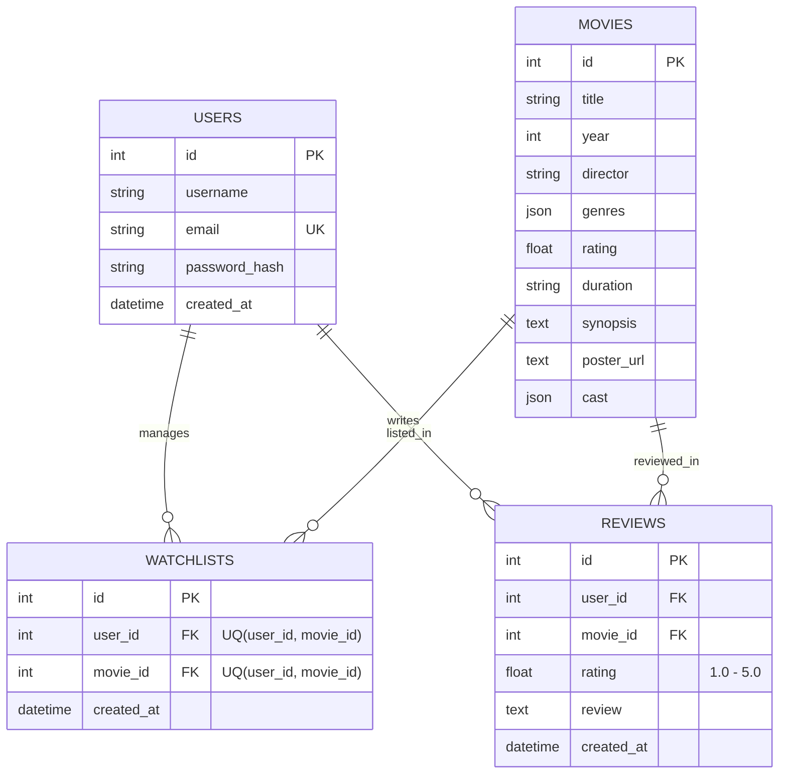

# 🎬 FilmLog — Movie Watchlist & AI Recommendation API
**GDGoC Universitas Gadjah Mada — Hacker Back-End Technical Assignment**

Backend RESTful API untuk platform katalog film, manajemen *watchlist* personal, pencatatan riwayat tontonan & ulasan (*reviews*), serta sistem rekomendasi film cerdas berbasis **Google Gemini LLM** yang di-*grounding* langsung ke database lokal.

---

## 🏗️ Tech Stack & Arsitektur
* **Framework:** Python + FastAPI
* **Database & ORM:** SQLite + SQLAlchemy 2.0 (Relational DBMS dengan penegakan `FOREIGN KEY` & `UNIQUE CONSTRAINT`)
* **Authentication & Security:** Bcrypt Password Hashing (`bcrypt`) + JSON Web Token (`PyJWT` HS256 Bearer Auth)
* **Data Validation:** Pydantic v2
* **AI Integration:** Google GenAI SDK (`google-genai`) dengan *Structured Outputs* (`response_schema`) & *Local Database Grounding*
* **Testing & Deployment:** Pytest + HTTPX (`TestClient`) & Docker

---

## 🗄️ Entity Relationship Diagram (ERD)

Skema database dirancang menggunakan 4 entitas relasional. Tabel `watchlists` dan `reviews` berfungsi sebagai *junction/associative tables* yang menghubungkan `users` dan `movies` dengan relasi `Many-to-One` (`ON DELETE CASCADE`).



---

## 🚀 Cara Menjalankan Aplikasi (Setup Instructions)

### 1. Prerequisites
* Python 3.10+
* Google Gemini API Key (Gratis melalui [Google AI Studio](https://aistudio.google.com/apikey))

### 2. Konfigurasi Environment Variables
Salin file template `.env.example` menjadi `.env` di dalam direktori `backend/`:

```bash
cp backend/.env.example backend/.env
```

Isi variabel di dalam `backend/.env`:
```env
DATABASE_URL=sqlite:///./filmlog.db
JWT_SECRET=super-secret-jwt-key-change-in-production
JWT_ALGORITHM=HS256
JWT_EXPIRE_MINUTES=1440
GEMINI_API_KEY=masukkan_api_key_gemini_anda_disini
```

### 3. Instalasi Dependencies & Database Seeding
```bash
python3 -m venv backend/.venv
source backend/.venv/bin/activate
pip install -r backend/requirements.txt

# Jalankan database migration & seeder 20 film awal
python backend/seed.py
```

### 4. Menjalankan Server Backend
```bash
uvicorn app.main:app --app-dir backend --reload --port 8000
```
*(Catatan: Saat server menyala, aplikasi juga memiliki mekanisme auto-seed otomatis apabila database masih kosong).*

* **Base API URL:** `http://localhost:8000/api`
* **Interactive Swagger UI Docs:** `http://localhost:8000/docs`
* **Companion Frontend:** Buka file `frontend/index.html` di browser dan pastikan *API Base URL* di pojok kanan atas mengarah ke port tempat `uvicorn` berjalan.

### 5. Menjalankan Automated Integration Tests
```bash
pytest backend/tests/ -v
```

### 6. Menjalankan dengan Docker (Opsional)
```bash
docker compose up --build
```

---

## 📑 Ringkasan Endpoint REST API

| Method | Endpoint | Auth | Deskripsi | Status Codes |
| :--- | :--- | :--- | :--- | :--- |
| `POST` | `/api/auth/register` | Public | Registrasi akun user baru (Bcrypt hash) | `201`, `400`, `409` |
| `POST` | `/api/auth/login` | Public | Autentikasi user & generate JWT token | `200`, `401` |
| `GET` | `/api/movies` | Public | Daftar film (mendukung `?genre=` & `?search=`) | `200` |
| `GET` | `/api/movies/{id}` | Public | Detail lengkap satu film | `200`, `404` |
| `GET` | `/api/watchlist` | Bearer JWT | Daftar film di watchlist user aktif | `200`, `401` |
| `POST` | `/api/watchlist` | Bearer JWT | Tambah film ke watchlist (anti-duplikat) | `201`, `401`, `404`, `409` |
| `DELETE` | `/api/watchlist/{movieId}` | Bearer JWT | Hapus film dari watchlist user | `200`, `401`, `404` |
| `GET` | `/api/watched` | Bearer JWT | Riwayat film yang sudah ditonton & di-review | `200`, `401` |
| `POST` | `/api/watched` | Bearer JWT | Catat film sudah ditonton + rating (1-5) & review | `201`, `400`, `401`, `404` |
| `POST` | `/api/movies/recommend` | Public | Rekomendasi film via Gemini AI (Local DB Grounded) | `200`, `400`, `502` |

---

## 🤖 Strategi Prompt Grounding Gemini AI
Untuk memastikan Gemini **hanya** merekomendasikan film yang benar-benar ada di dalam database lokal (`20 film`), endpoint `POST /api/movies/recommend` menerapkan 3 lapis validasi:
1. **Dynamic Context Injection:** Mengambil katalog film aktif dari SQLite (`id`, `title`, `year`, `director`, `genres`, `rating`, `synopsis`) dan menyuntikkannya ke dalam `system_instruction`.
2. **Structured JSON Output (`response_schema`):** Memaksa model Gemini mengembalikan output sesuai skema Pydantic `GeminiOutputSchema` (`movie_id: int` dan `reasoning: str`) dengan `temperature=0.2`.
3. **Post-Generation Verification:** Memvalidasi ulang `movie_id` yang dipilih AI terhadap primary key di database lokal sebelum mengembalikan respons ke client.
